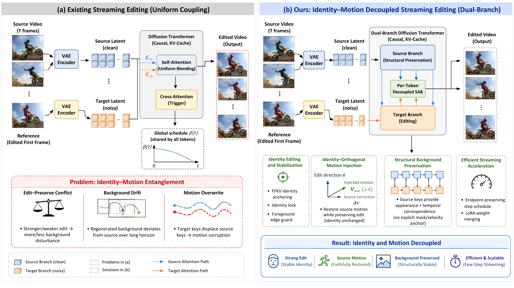
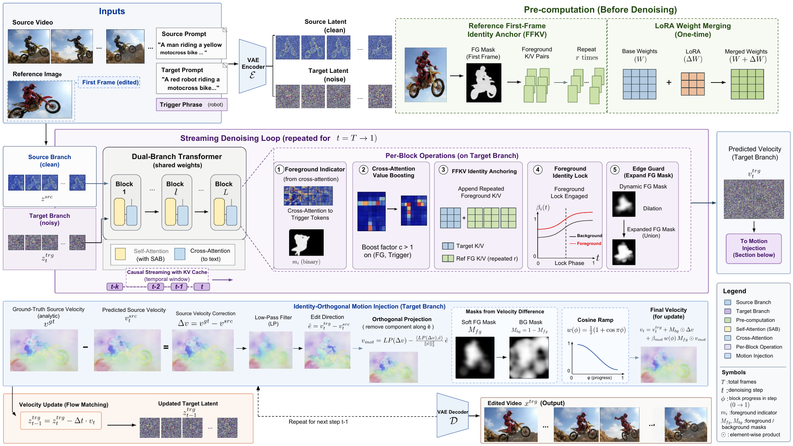

# RefStreamEdit

**Reference-Guided Video Editing via Few-Step Streaming Video Generation with Disentangled Identity and Motion**

Qi Si, Zhao Zhang, Yang Zhao, Zhongqiu Zhao, Haijun Zhang, Meng Wang

[](https://github.com/sqsiqi/RefStreamEdit)
[](https://github.com/sqsiqi/RefStreamEdit)

<p align="center">
  
</p>

## Pre-release note

This is the official code release for the paper. The core identity--motion decoupling
modules are temporarily withheld and will be released upon acceptance. The withheld
part covers the per-token foreground--background bridge, cross-attention value boosting,
reference-first-frame key--value anchoring, the late identity lock, the foreground edge
guard, and the identity-orthogonal motion injection, together with the task LoRA.

This release provides the public inference interface, the paper's configuration, the
benchmark protocol, and the base streaming pipeline. It is intended for inspection,
integration, and reproducibility of the experimental setup. The `refstreamedit` package
exposes the same entry point that the full release will use; the core hook currently
raises a clear `CoreNotReleasedError`.

## Highlights

- Reference-image-guided video editing on a few-step streaming generator.
- A per-token foreground--background bridge that replaces the global blending schedule
  of streaming editors.
- Foreground identity injection through value boosting, reference-first-frame KV
  anchoring, and a late identity lock.
- Identity-orthogonal motion injection that restores source dynamics without pulling the
  appearance back toward the source.
- An endpoint-preserving 8-step schedule and merged LoRA weights.
- No per-video optimization. The method is $1.64\times$ faster than StreamEdit with
  $30.8\%$ less peak memory, while giving the best foreground identity, background
  preservation, and coverage on the two benchmarks used in the paper.

## Method

<p align="center">
  
</p>

A source branch and a noisy target branch are processed in parallel by a streaming
diffusion transformer. The foreground enhancement group, the edge guard, and the
identity-orthogonal motion injection act on the dual-branch features. The background is
preserved structurally by the source branch, so no explicit background anchor is needed.
An endpoint-preserving few-step schedule and merged LoRA weights keep inference cheap.

The design follows two observations from the paper:

1. Under any global blending schedule, the ratio between background deviation and
   foreground edit energy is invariant to the blend strength. The per-token bridge breaks
   this invariance.
2. The source velocity correction contains a motion component and an appearance
   component. Projecting out the edit direction leaves a motion-only correction that can
   be injected without disturbing the edited identity.

See [`docs/METHOD.md`](docs/METHOD.md) for the full method description and
[`docs/BENCHMARK.md`](docs/BENCHMARK.md) for the benchmark construction and metrics.

## Repository layout

```text
refstreamedit/                  Public interface and core hook
  core/                         Placeholder for the withheld core modules
  pipeline.py                   RefStreamEditPipeline
  io.py                         Video/image validation helpers
  demo.py                       Command-line demo
configs/refstreamedit.yaml      Paper hyper-parameters
third_party/LongLive_StreamEdit Base streaming pipeline (Apache-2.0)
docs/                           Method and benchmark notes
scripts/                        Checkpoint download and demo scripts
assets/                         Teaser and overview figures
```

## Environment

```bash
conda create -n refstreamedit python=3.12 -y
conda activate refstreamedit

# Choose the PyTorch command appropriate for your CUDA version (example for CUDA 12.8).
pip install torch==2.8.0 torchvision==0.23.0 --index-url https://download.pytorch.org/whl/cu128

pip install -r requirements.txt
pip install flash-attn --no-build-isolation
```

The base streaming pipeline lives in `third_party/LongLive_StreamEdit`. For the
upstream LongLive installation notes, see
[`third_party/LongLive_StreamEdit/README.md`](third_party/LongLive_StreamEdit/README.md).

## Checkpoints

```bash
bash scripts/download_checkpoints.sh
```

The script downloads:

- `Wan-AI/Wan2.1-T2V-1.3B`
- `Efficient-Large-Model/LongLive`

The task LoRA and the core editing modules are part of the withheld release and will be
uploaded together with the full code upon acceptance.

## Running

The public entry point is:

```bash
python -m refstreamedit.demo \
  --source path/to/source.mp4 \
  --reference path/to/reference.png \
  --prompt "Change the city bus to a double-decker bus." \
  --output outputs/edited.mp4
```

The demo validates the inputs, loads the paper configuration, and calls the core hook.
Until the core release, it stops with:

```text
CoreNotReleasedError: The core identity-motion decoupling modules are not included in
this pre-release. They will be released upon acceptance.
```

The same interface will be used by the full release, so the command and configuration do
not need to change after the core modules are added.

## Evaluation protocol

The paper uses two benchmarks:

- **Ref-Five-Bench-A**: 100 source videos from FiVE-Bench with paired object masks and
  replacement prompts.
- **Ref-Five-Bench-B**: 148 videos, consisting of 98 FiVE-Bench sources with re-authored
  targets, 25 gameplay clips, and 25 product clips.

Nine metrics are grouped into four families: foreground editing fidelity (DreamSim, CLIP),
motion fidelity (mEPE), background preservation (BG-LPIPS, BG-DINO, BG-SSIM, BG-PSNR),
and consistency (coverage@0.30, temporal consistency). All metrics use 16 uniformly
sampled frames per video. See [`docs/BENCHMARK.md`](docs/BENCHMARK.md) for the exact
definitions and construction details.

## Release plan

| Component | This release | Full release |
| --- | --- | --- |
| Inference interface and configs | Yes | Yes |
| Base streaming pipeline | Yes | Yes |
| Benchmark protocol | Yes | Yes |
| Core identity--motion modules | No | Yes |
| Task LoRA | No | Yes |
| Training/evaluation scripts | Partial | Yes |

The core modules and the task LoRA will be released after the paper is accepted.

## Acknowledgements

This repository builds on the excellent open-source work of
[LongLive](https://github.com/NVlabs/LongLive),
[StreamEdit](https://github.com/DSL-Lab/StreamEdit),
[Wan2.1](https://github.com/Wan-Video/Wan2.1), and
[FiVE-Bench](https://github.com/MinghanLi/FiVE-Bench). The base streaming pipeline in
`third_party/LongLive_StreamEdit` is derived from StreamEdit's LongLive implementation
and is redistributed under the Apache-2.0 license. Please keep the upstream licenses and
cite the corresponding works when using this code.

## Citation

If you find this work useful, please cite:

```bibtex
@article{si2026refstreamedit,
  title   = {Reference-Guided Video Editing via Few-Step Streaming Video Generation with Disentangled Identity and Motion},
  author  = {Si, Qi and Zhang, Zhao and Zhao, Yang and Zhao, Zhongqiu and Zhang, Haijun and Wang, Meng},
  journal = {arXiv preprint},
  year    = {2026}
}
```

## License

This repository is released under the Apache License 2.0. See [`LICENSE`](LICENSE) and
[`NOTICE`](NOTICE) for details. The vendored base pipeline retains its original license
and attribution.
